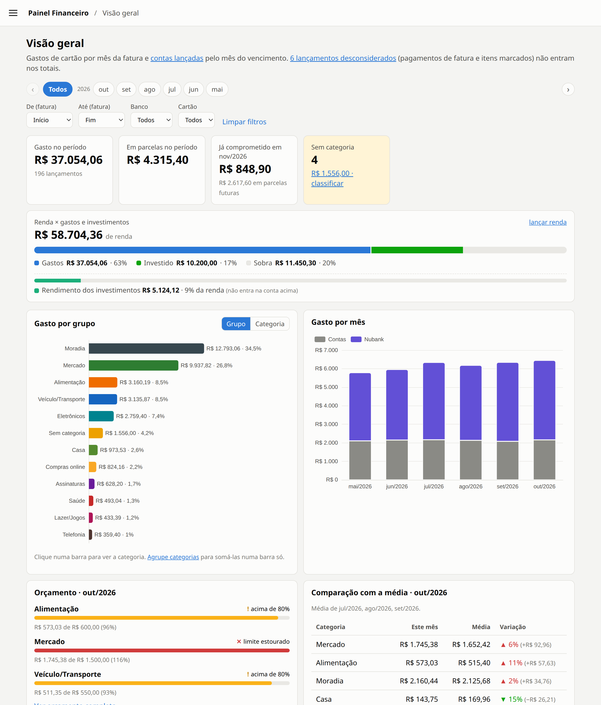
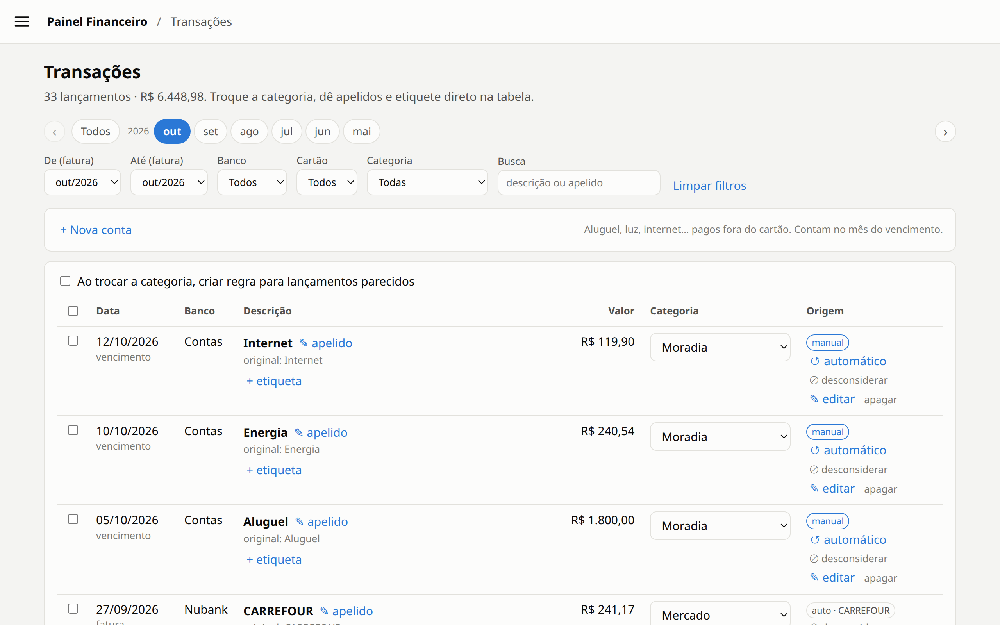
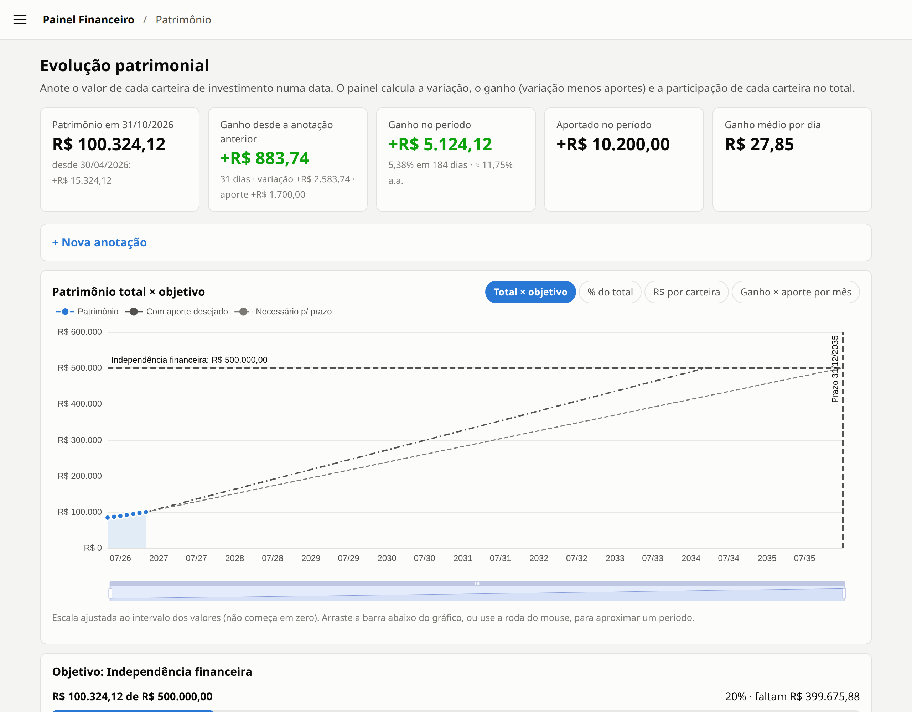
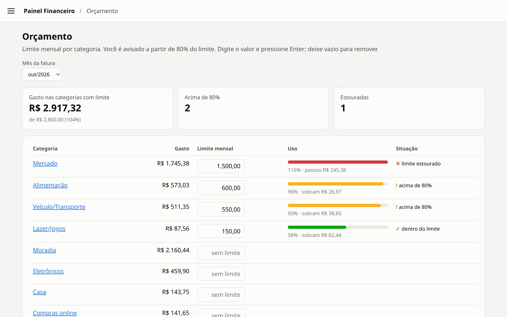
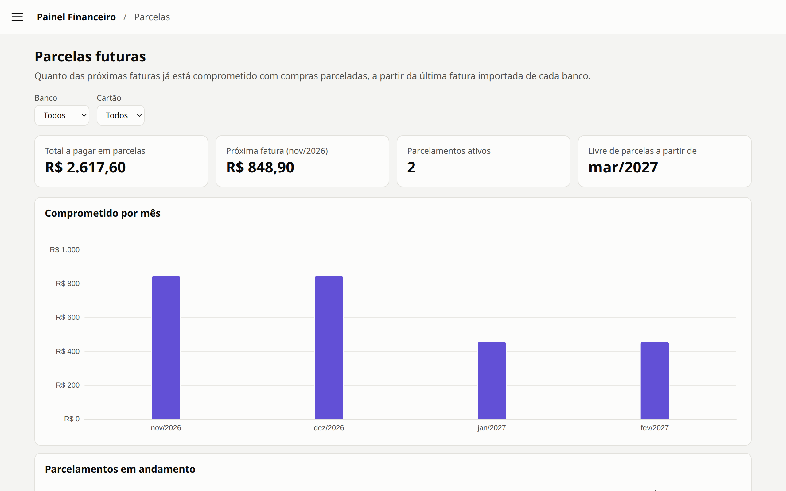
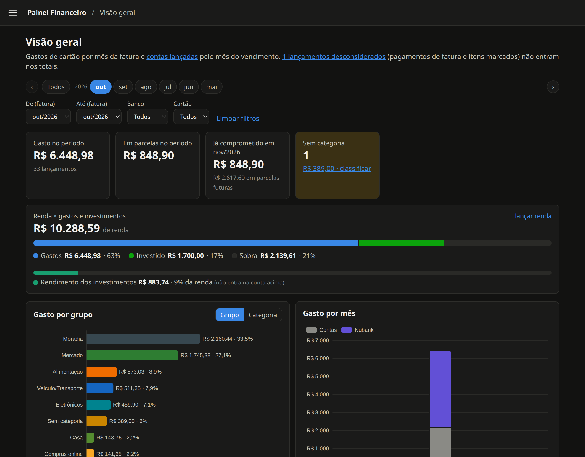
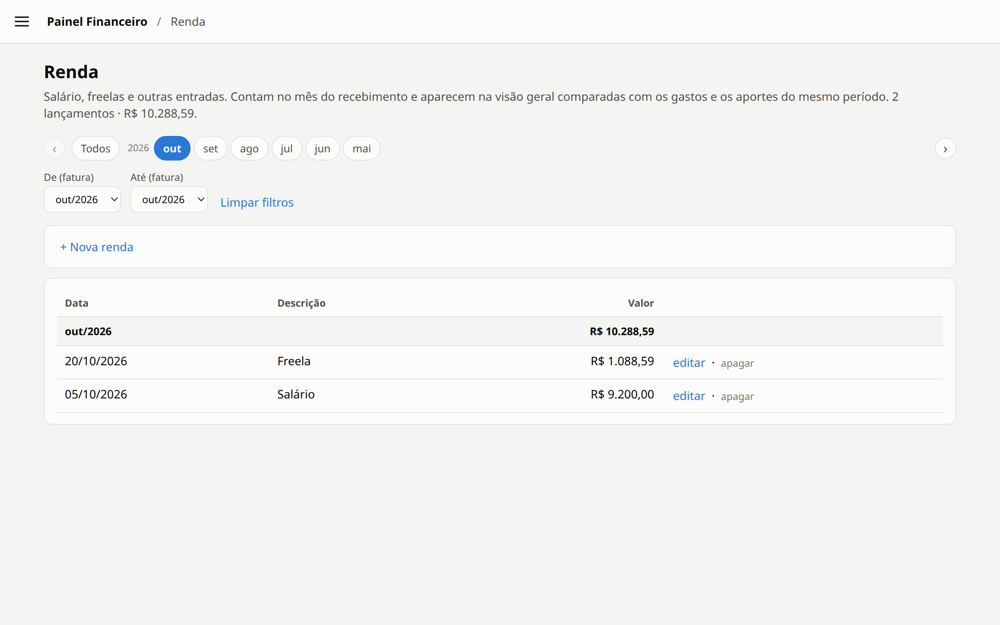
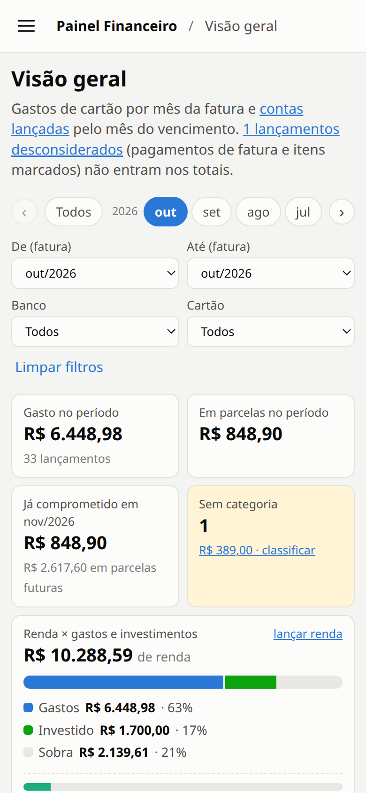

<div align="center">

# 💳 Painel Financeiro

**Controle pessoal de cartões, contas, renda e patrimônio, self-hosted e sem nuvem.**

Importe as faturas do cartão, deixe as regras categorizarem os gastos e acompanhe para onde vai o dinheiro, quanto sobra da renda e como o patrimônio evolui.


[](LICENSE)

<br>



<sub>Capturas feitas com o banco de demonstração (<code>npm run demo</code>). Todos os dados são fictícios.</sub>

</div>

---

## ✨ Funcionalidades

| | |
|---|---|
| 📥 **Importação de faturas** | Arraste o PDF do **Inter** ou o CSV do **Nubank**. O banco é detectado pelo conteúdo, e reimportar o mesmo arquivo ou transações repetidas não duplica nada. |
| 🏷️ **Categorias automáticas** | Regras por texto ou regex, por banco ou globais. Ao trocar a categoria na tabela, dá para criar a regra para os próximos lançamentos parecidos. Categorias podem ser agrupadas. |
| 📊 **Visão geral** | Gasto por grupo/categoria, gasto por mês e banco, orçamento do mês e comparação com a média dos 3 meses anteriores. |
| 💰 **Renda × gastos e investimentos** | Barra do tamanho da renda, preenchida pelos gastos e pelos aportes, mostrando a sobra (ou quanto passou da renda). O rendimento dos investimentos aparece à parte. |
| 🧾 **Contas fora do cartão** | Aluguel, luz, internet... lançados à mão e somados no mês do vencimento. |
| 🔁 **Parcelas e assinaturas** | Quanto já está comprometido nos próximos meses, e assinaturas recorrentes com alerta de preço novo ou cobrança ausente. |
| 🎯 **Orçamento** | Limite por categoria, com aviso acima de 80% e quando estoura. |
| 📈 **Patrimônio** | Valor de cada carteira por data, ganho real (variação − aportes), rentabilidade ao ano e projeção até um objetivo com prazo. |
| 🚫 **Desconsiderados** | Pagamentos de fatura saem dos totais automaticamente. Estornos e transferências podem ser marcados à mão ou por regra. |
| 📱 **Celular e tema escuro** | Layout próprio para telas estreitas, segue o tema do sistema, e os campos de valor têm máscara de dinheiro como nos apps de banco. |

## 🖼️ Telas

<table>
  <tr>
    <td width="50%"><p align="center"><b>Transações</b>: categoria, apelido e etiquetas direto na tabela</p></td>
    <td width="50%"><p align="center"><b>Patrimônio</b>: evolução e projeção até o objetivo</p></td>
  </tr>
  <tr>
    <td><p align="center"><b>Orçamento</b> por categoria</p></td>
    <td><p align="center"><b>Parcelas</b> futuras mês a mês</p></td>
  </tr>
  <tr>
    <td><p align="center"><b>Tema escuro</b></p></td>
    <td><p align="center"><b>Renda</b> lançada por mês</p></td>
  </tr>
</table>

<p align="center">
  <br>
  <b>No celular</b>
</p>

## 🚀 Começando

Requer **Node.js 24+** (usa o `node:sqlite` nativo, sem dependências de compilação).

```bash
git clone https://github.com/leofazanaro/LOF_Financial.git painel-financeiro
cd painel-financeiro
npm install
cp .env.example .env   # ajuste host, porta e senha
npm start
```

Abra <http://localhost:3000>. O banco é criado em `data/financeiro.db` na primeira execução, e as migrações rodam sozinhas.

### Quer só olhar?

Gere um banco com seis meses de dados fictícios e suba o painel apontando para ele:

```bash
npm run demo -- /tmp/demo.db
DB_PATH=/tmp/demo.db PORT=3001 npm start
```

## ⚙️ Configuração

Variáveis do `.env` (veja [`.env.example`](.env.example)):

| Variável | Padrão | Descrição |
|---|---|---|
| `HOST` | `127.0.0.1` | `0.0.0.0` para acessar pelo IP da rede (celular, outro PC) |
| `PORT` | `3000` | Porta do servidor |
| `APP_USER` / `APP_PASSWORD` | – | Com senha definida, o navegador pede login (HTTP Basic). **Defina sempre que abrir na rede.** |
| `DB_PATH` | `data/financeiro.db` | Arquivo do banco SQLite |

> [!IMPORTANT]
> A pasta `data/` guarda o banco e uma cópia de cada fatura importada. Ela está no `.gitignore` e **nunca deve ser versionada**. Faça backup dela por fora.

## 🖥️ Linha de comando

| Comando | O que faz |
|---|---|
| `npm run import -- fatura.pdf outra.csv` | Importa faturas sem abrir o navegador |
| `npm run cat -- pendentes` | Lista, categoriza e cria regras (`npm run cat` mostra a ajuda) |
| `npm run contas -- contas.csv [--gravar]` | Lança contas a partir de uma planilha (sem `--gravar`, só simula) |
| `npm run reconstruir -- aportes.csv [--gravar]` | Estima o patrimônio passado a partir dos aportes mensais por carteira |
| `npm run demo -- arquivo.db` | Cria um banco de demonstração com dados fictícios |
| `npm test` | Roda os testes (`node --test`) |

## 🐧 Rodando como serviço (systemd)

O arquivo [`deploy/painel-financeiro.service`](deploy/painel-financeiro.service) sobe o painel no boot como serviço do usuário, sem `sudo`:

```bash
mkdir -p ~/.config/systemd/user
ln -sf "$PWD/deploy/painel-financeiro.service" ~/.config/systemd/user/
systemctl --user daemon-reload
systemctl --user enable --now painel-financeiro
loginctl enable-linger "$USER"   # inicia mesmo sem login
```

Logs: `journalctl --user -u painel-financeiro -f`. Depois de atualizar o código do servidor, rode `systemctl --user restart painel-financeiro`. Mudanças só em `public/` aparecem ao recarregar a página.

## 🧱 Arquitetura

```
src/
├── server.js          rotas da API (Fastify) e arquivos estáticos
├── db/                conexão SQLite e migrações numeradas (001_…sql)
├── importers/         um módulo por banco: detectar() + importar()
├── importacao.js      grava faturas, evita duplicadas, aplica regras
├── consultas.js       resumos e filtros do painel
├── categorias.js      categorias, grupos e regras
├── analises.js        parcelas, assinaturas, orçamento, comparação
├── contas.js · renda.js · patrimonio.js · desconsiderar.js
public/                frontend em JS puro (ESM) + ECharts, sem build
scripts/               ferramentas de linha de comando
test/                  testes com node:test e banco em memória
```

- Valores sempre em **centavos** (inteiros), sem erro de arredondamento.
- Gastos do cartão contam no **mês da fatura**; contas, no mês do vencimento; renda, no mês do recebimento.
- A descrição original do banco nunca é alterada: categoria, apelido e etiquetas ficam à parte.

### Adicionando um banco

Crie um módulo em `src/importers/` que exporte `detectar({ nome, texto })` e `importar({ nome, texto })` devolvendo `{ banco, formato, fatura, transacoes }` (veja [`nubank-csv.js`](src/importers/nubank-csv.js)), e registre-o em [`src/importers/index.js`](src/importers/index.js).

## 🔒 Privacidade

Tudo roda na sua máquina: sem conta, sem nuvem, sem telemetria. Os dados ficam num único arquivo SQLite que é seu.

## 📄 Licença

Distribuído sob a licença [MIT](LICENSE). Use, modifique e compartilhe à vontade.

---

<div align="center">
<sub>Feito com ☕ por <a href="https://github.com/leofazanaro">Leonardo Fazanaro</a>.</sub>
</div>
